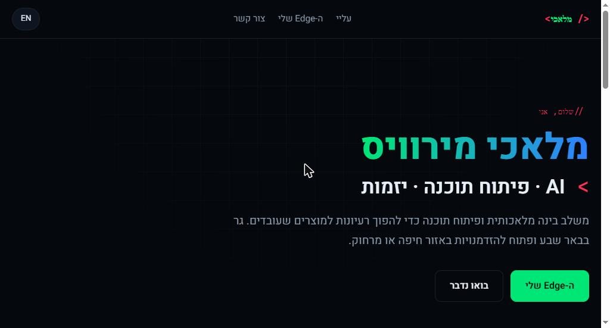

# malachi-mirvis.com

My personal website: a bilingual (Hebrew / English) portfolio page with a Matrix-style intro.

**Live:** https://malachi-mirvis.com

## Features

- **Matrix intro:** green `0` / `1` digital rain drawn on a `<canvas>`, with a typed-out name. Click or press any key to skip. It is turned off for visitors who prefer reduced motion.
- **Hebrew + English:** one click switches the language and the page direction (RTL / LTR). The choice is remembered.
- **Content in one place:** all text lives in two objects (`PROFILE` and `TEXT`) at the bottom of `index.html`. Empty sections (skills, experience, projects) hide themselves and their menu links.
- **Brand colors:** green, blue and red, defined once as CSS variables.
- **Contact icons:** inline SVG logos for GitHub, LinkedIn, WhatsApp, phone, Gmail and X.
- **No build step:** a single HTML file with plain CSS and JavaScript. No framework, no dependencies.

## Run locally

Open `index.html` in a browser. That's it.

## Deploy

Hosted on Netlify, with the domain managed at Hostinger (an `A` record for the root and a `CNAME` for `www`).

## Tech

HTML · CSS · JavaScript · Canvas API
